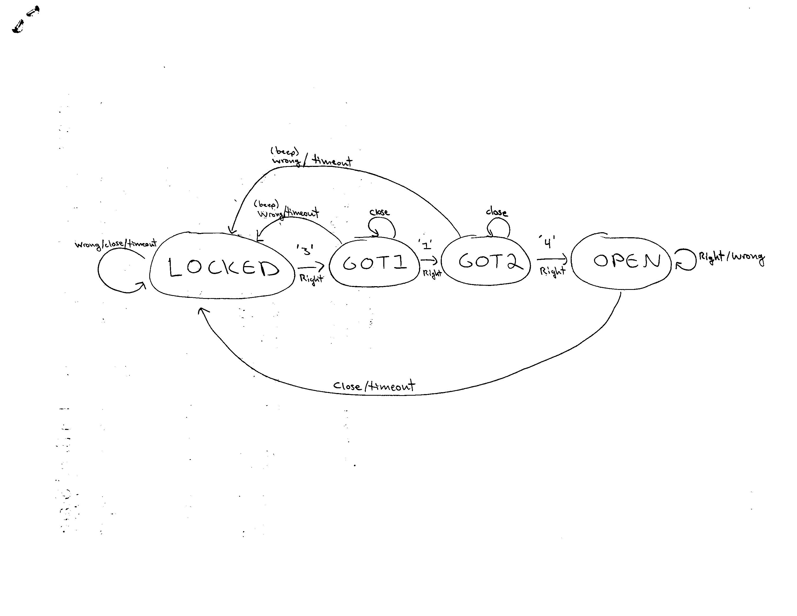

# HW5: Combination Lock FSM

`lock.h` / `lock.c` hold a finite state machine for a combination lock with the code 3-1-4,
written as a transition table indexed by state and event. `main.c` reads characters from
standard input, turns each into an event, steps the machine, and prints what happened.
`tests/test_lock.c` holds the tests for the lock functions.

## Build

From the `hw05/` directory:

```sh
make
```

This builds `lock` with `-std=c11 -Wall -Wextra -g -fsanitize=address,undefined`.

## Run

```sh
./lock < data/codes.txt
```

`lock` starts in `LOCKED` and reads one character at a time. A digit is `RIGHT` if it is the
next digit of the code and `WRONG` otherwise, `c` is the door closing, and `t` is the timer
running out; every other character (spaces, newlines, ...) is skipped. It prints one line
per event as `STATE char EVENT -> NEXT ACTION`, for example `GOT2 4 RIGHT -> OPEN UNLOCK`,
then a last line `final: STATE`.

## Test

```sh
make test
```

This builds the tests if needed, then runs `./tests/test_lock`. It prints `PASS` or `FAIL`
for each check and then a summary. It exits with status 0 when every check passes and 1
when any check fails.

## Clean

```sh
make clean
```

This removes `main.o`, `lock.o`, `tests/test_lock.o`, `lock`, and `tests/test_lock`.

## State Diagram



## Transition Table

Each cell is `next state / action`.

| State  | RIGHT            | WRONG           | CLOSE           | TIMEOUT         |
|--------|------------------|-----------------|-----------------|-----------------|
| LOCKED | GOT1 / NONE      | LOCKED / BEEP   | LOCKED / NONE   | LOCKED / NONE   |
| GOT1   | GOT2 / NONE      | LOCKED / BEEP   | GOT1 / NONE     | LOCKED / NONE   |
| GOT2   | OPEN / UNLOCK    | LOCKED / BEEP   | GOT2 / NONE     | LOCKED / NONE   |
| OPEN   | OPEN / NONE      | OPEN / NONE     | LOCKED / LOCK   | LOCKED / LOCK   |
